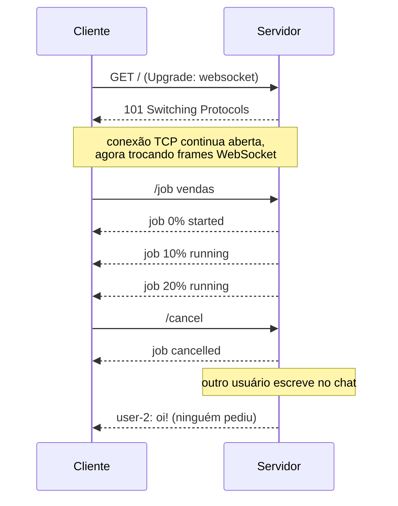

# Push com WebSocket

No request-response, o servidor só fala quando é perguntado. No **push**, o cliente abre uma conexão que fica aberta, e o servidor envia dados **assim que eles existem**, sem ninguém pedir.

## O ciclo



1. **O WebSocket nasce como HTTP.** O cliente faz uma requisição comum com o cabeçalho `Upgrade: websocket`. O servidor responde `101 Switching Protocols`, e a partir daí a mesma conexão TCP para de falar HTTP.
2. **Canal bidirecional.** Cliente e servidor mandam mensagens (frames) quando quiserem, nos dois sentidos, sem o ritual de requisição → resposta.
3. **Conexão com estado.** O servidor guarda quem está conectado. Isso habilita o push, mas também significa que ele precisa reagir quando uma conexão cai.

## O lab

Dois usos de push numa mesma conexão:

- **Chat** (como na aula): uma mensagem de um cliente é empurrada para todos os conectados.
- **Job** (nosso cenário): `/job <nome>` inicia um job, e o servidor empurra o progresso de 10 em 10%. `/cancel` cancela no meio.

| Arquivo | O que faz |
|---|---|
| `server.js` | Servidor HTTP que entrega a página e faz upgrade para WebSocket (lib `ws`) |
| `index.html` | Cliente de navegador: chat + barra de progresso dos jobs |
| `cli-client.js` | Cliente de terminal, com o WebSocket nativo do Node 22+ |

### Como rodar

Requer Node 22+ (o cliente de terminal usa o `WebSocket` nativo).

```bash
npm install
npm start                          # ou: JOB_STEP_MS=300 npm start (jobs mais rápidos)
```

Abra `http://localhost:3000` em **duas ou mais abas**, ou use o terminal com `npm run client`. Dá para misturar navegador e terminal no mesmo chat.

### Experimentos

**1. Push no chat.** Escreva numa aba. A mensagem aparece nas outras instantaneamente, sem que elas tenham perguntado nada. No request-response, as outras abas teriam que ficar consultando o servidor para descobrir mensagens novas.

**2. Push de progresso.** Digite `/job vendas`. O progresso chega sozinho, passo a passo. Compare com o lab anterior: lá o cliente ficava cego por 5 segundos e só recebia o resultado final.

**3. Cancelamento real.** Inicie um job e digite `/cancel` no meio. No request-response, o cliente que desistia não tinha como avisar o servidor, que continuava trabalhando. Aqui o canal é bidirecional, e o servidor para de verdade (`clearInterval`).

**4. Cliente cai no meio.** Inicie um job e feche a aba (ou Ctrl+C no terminal). O log do servidor mostra `job "x" cancelado`: o evento `close` permite liberar os recursos de quem não vai mais receber nada.

**5. O handshake.** Veja o upgrade acontecendo:

```bash
curl -i -H 'Connection: Upgrade' -H 'Upgrade: websocket' \
  -H 'Sec-WebSocket-Version: 13' -H 'Sec-WebSocket-Key: dGhlIHNhbXBsZSBub25jZQ==' \
  localhost:3000/
```

A resposta é `101 Switching Protocols`. No navegador, abra DevTools → Network → filtro **WS** e clique na conexão para ver cada frame trafegando.

## O que aprendi

- **Tempo real de verdade.** O dado chega ao cliente assim que existe. Ideal para chat, notificações, jogos multiplayer, dashboards ao vivo, colaboração.
- **Bidirecional.** O cliente pode falar com o servidor no meio de uma operação, o que tornou o cancelamento possível.
- **Conexão com estado tem custo.** Cada cliente ocupa uma conexão aberta e memória no servidor, mesmo parado. Com milhares de usuários, isso pesa.
- **Escalar horizontalmente é difícil.** O `Map` de clientes vive na memória de *um* processo. Com duas instâncias atrás de um load balancer, um usuário conectado na instância A não recebe mensagens enviadas por alguém na B. A solução costuma ser um pub/sub entre as instâncias (Redis, RabbitMQ), o que volta mais adiante na seção.
- **O cliente pode não aguentar.** O servidor empurra sem perguntar se o cliente está pronto. Um cliente lento ou sobrecarregado pode acumular mensagens que não consegue processar.
- **Desconexões são normais.** Rede móvel, proxies com timeout de inatividade e Wi-Fi caindo fazem parte da vida. Clientes de produção precisam reconectar e o servidor precisa de *heartbeats* (ping/pong) para detectar conexões mortas.

