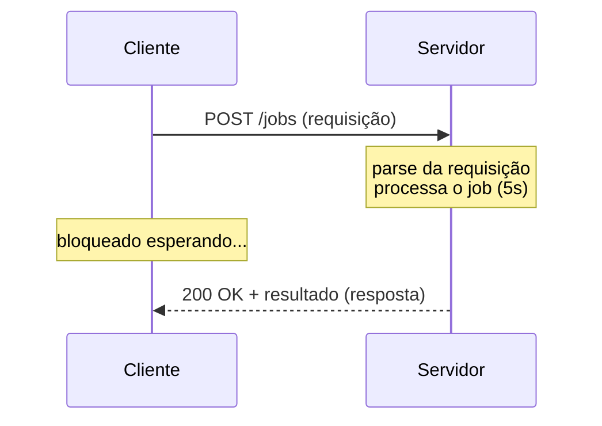

# Request-Response

O padrão mais básico da web: o cliente envia uma requisição e espera; o servidor processa e devolve uma resposta. Uma requisição, uma resposta.

## O ciclo



O que acontece por baixo, em cada requisição:

1. **Cliente envia a requisição**: abre (ou reaproveita) uma conexão TCP e escreve bytes no socket.
2. **Servidor faz o parse**: lê os bytes até identificar onde a requisição termina. Em HTTP/1.1 isso é feito pelos cabeçalhos (`\r\n\r\n` separa cabeçalho do corpo, e `Content-Length` diz o tamanho do corpo).
3. **Servidor processa** a requisição.
4. **Servidor envia a resposta**, que também passa por serialização (JSON) e pelo socket.
5. **Cliente faz o parse da resposta** e consome o resultado.

Cada uma dessas etapas tem custo. O parse, por exemplo, depende do protocolo e do formato (JSON, XML, Protobuf).

## Onde aparece

HTTP, DNS, SSH, consultas a banco de dados (SQL), RPC, gRPC (no modo unário). Praticamente tudo que você já usou.

## O lab

Cenário de jobs: o cliente envia um job (gerar um relatório) e o servidor só responde quando ele termina. Feito em Node puro, sem framework, para ver o protocolo sem abstrações.

| Arquivo | O que faz |
|---|---|
| `server.js` | Servidor HTTP com `POST /jobs` (demora 5s) e `GET /health` (imediato) |
| `client.js` | Envia um job e mede quanto tempo ficou esperando. Aceita um timeout opcional |

### Como rodar

Requer Node 18+ (usa `fetch` nativo). Sem dependências.

```bash
node server.js                        # terminal 1
JOB_DURATION_MS=2000 node server.js   # (opcional) jobs mais curtos
```

### Experimentos

**1. O ciclo básico.** Em outro terminal:

```bash
node client.js
```

O cliente fica parado ~5s e então recebe o resultado.

**2. O servidor continua atendendo.** Enquanto um job roda, em um terceiro terminal:

```bash
curl localhost:3000/health
```

Responde na hora. O job usa `setTimeout` (I/O assíncrono), então não bloqueia o event loop do Node. Quem fica bloqueado é o *cliente*, não o servidor.

**3. O cliente desiste.**

```bash
node client.js 2000
```

O cliente dá timeout em 2s, mas olhe o log do servidor: o job é **processado até o fim** mesmo assim, e a resposta é descartada. Trabalho desperdiçado. Se o cliente tentar de novo, o job roda duas vezes. (Isso volta na aula de idempotência.)

**4. Os bytes reais.**

```bash
curl -v -X POST localhost:3000/jobs -H 'Content-Type: application/json' -d '{"report":"vendas"}'
```

As linhas com `>` são a requisição que o curl enviou e as com `<` são a resposta do servidor. Repare que uma requisição HTTP/1.1 é só texto em um formato combinado: linha de requisição (`POST /jobs HTTP/1.1`), cabeçalhos, uma linha em branco e o corpo.

## O que aprendi

- **Simples e universal.** Fácil de entender, depurar, cachear e escalar. É o ponto de partida certo para a maioria das APIs.
- **Não serve bem para tarefas longas.** O cliente fica preso esperando; conexões ficam abertas; proxies, load balancers e o próprio cliente têm timeouts que cortam a espera (o experimento 3).
- **Desistir não cancela.** Quando o cliente desiste, o servidor normalmente não fica sabendo e continua trabalhando. Retentativas podem duplicar o efeito.
- **Não serve para notificações.** O servidor só fala quando é perguntado. Se algo acontecer do lado dele (um chat, um job concluído), não há como avisar o cliente.

Esses limites motivam os próximos labs: processar o job de forma **assíncrona** e devolver um `jobId` na hora, e depois descobrir quando ele terminou via **polling**, **long polling**, **SSE** ou **WebSocket**.

## Para explorar

- Escreva um cliente "cru" com o módulo `node:net`: abra um socket TCP na porta 3000 e escreva a requisição HTTP à mão (`POST /jobs HTTP/1.1\r\n`, cabeçalhos, `\r\n`, corpo). Se esquecer o `Content-Length` ou a linha em branco, o servidor não entende. É a melhor forma de perceber que HTTP é só texto.
- Troque o `setTimeout` em `processJob` por um loop que ocupa a CPU (`while (Date.now() < fim) {}`) e repita o experimento 2. O `/health` ainda responde? Por quê?
- Abra o Wireshark (ou `tcpdump -i lo port 3000 -A`) e veja o handshake TCP antes da requisição.